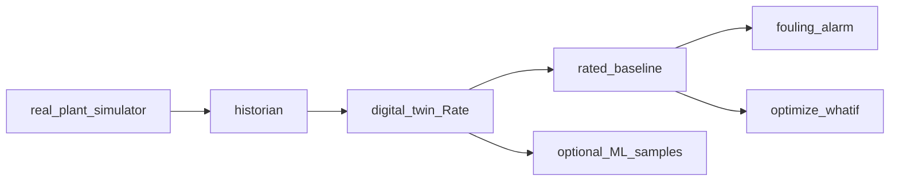

# Architecture: real_plant simulator, historian, digital twin

Detail (modes, DOF Change/substitute, Mermaid UML, dynamic kickoff): [`AS_BUILT_TWIN.md`](AS_BUILT_TWIN.md).

## Roles

| Layer | Job |
|---|---|
| **real_plant simulator** (`challenge/plant/`) | Dynamic ODEs, controllers, faults → **historian** |
| **digital twin** (`models/dwsim/`, `dwsim_twin.py`) | Parallel model: **Simulate / Rate / Optimize** and **fouling detection** |
| **Optional ML** (`scripts/twin_surrogate_sample.py`) | Sample digital-twin DOE surface for a future surrogate |

Inspired by Scott Duncan / HistorianRCA (CC BY 4.0). No external runtime data feed.



## Steady-state DOFs (Adjust, not PID)

| Loop | Steady state | Dynamics |
|---|---|---|
| LIC | Fix level SP; Fin = Fout → LV% | PID level → LV |
| TIC → FIC → TV | Fix T SP → TV% / steam from coil law | Cascade PIDs |

real_plant SS helpers: `scripts/twin_modes.py` (`simulate` / `rate` / `optimize`).  
digital twin helpers: `scripts/dwsim_twin_modes.py` (same modes + fouling).

## Fouling

At SS with T held, **duty** is fixed by energy balance. Fouling shows as **higher TV%** for the same duty:

`UA_eff = UA_clean × ua_multiplier × R^(x_TV − 1)`

Rate a clean window → baseline `ua_multiplier ≈ 1`. Rate a fouled window → drop (pilot E001 → ~0.6) with TV% up → **coil_fouling**.

```bash
python scripts/dwsim_twin_modes.py demo
python scripts/dwsim_twin_modes.py fouling
python scripts/twin_surrogate_sample.py -n 128
```

## Key files

| Path | Purpose |
|---|---|
| `challenge/plant/model.py` | real_plant dynamic simulator |
| `challenge/plant/ss_modes.py` | real_plant SS Simulate/Rate/Optimize |
| `challenge/plant/dwsim_twin.py` | digital twin rate / fouling / optimize / DOE |
| `models/dwsim/TK101_twin_ss.dwxmz` | digital twin flowsheet |
| `models/dwsim/twin_rated_baseline.json` | Clean rating |
| `scripts/run_pilot.py` | Generate historian from real_plant |
