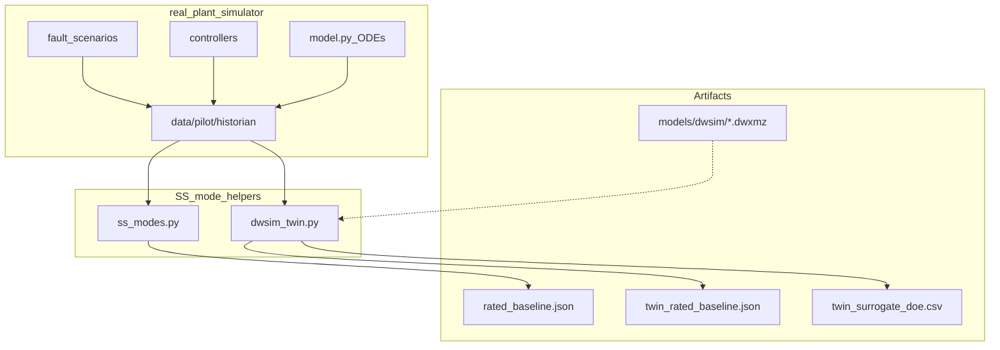
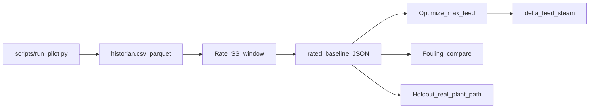
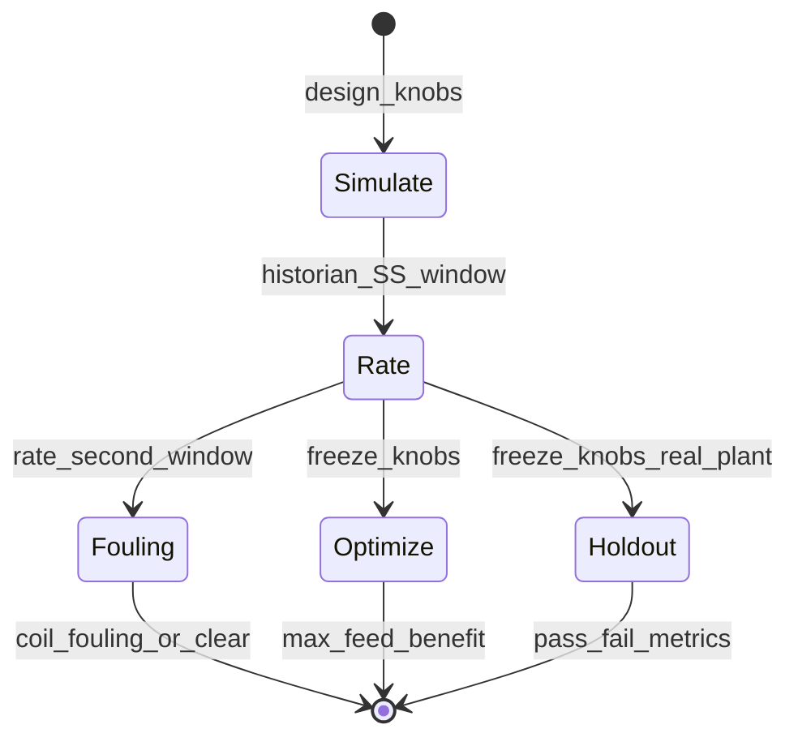
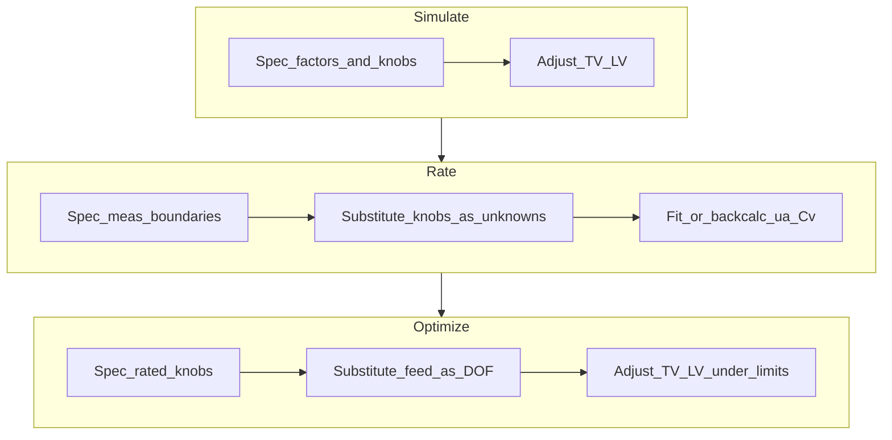
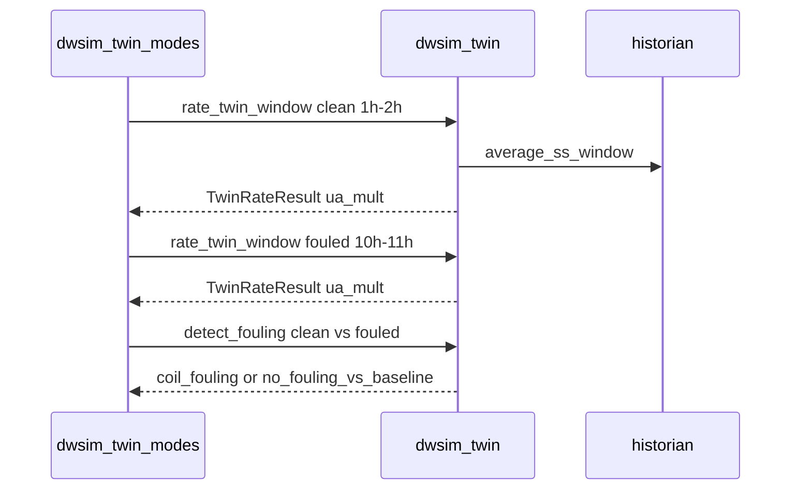
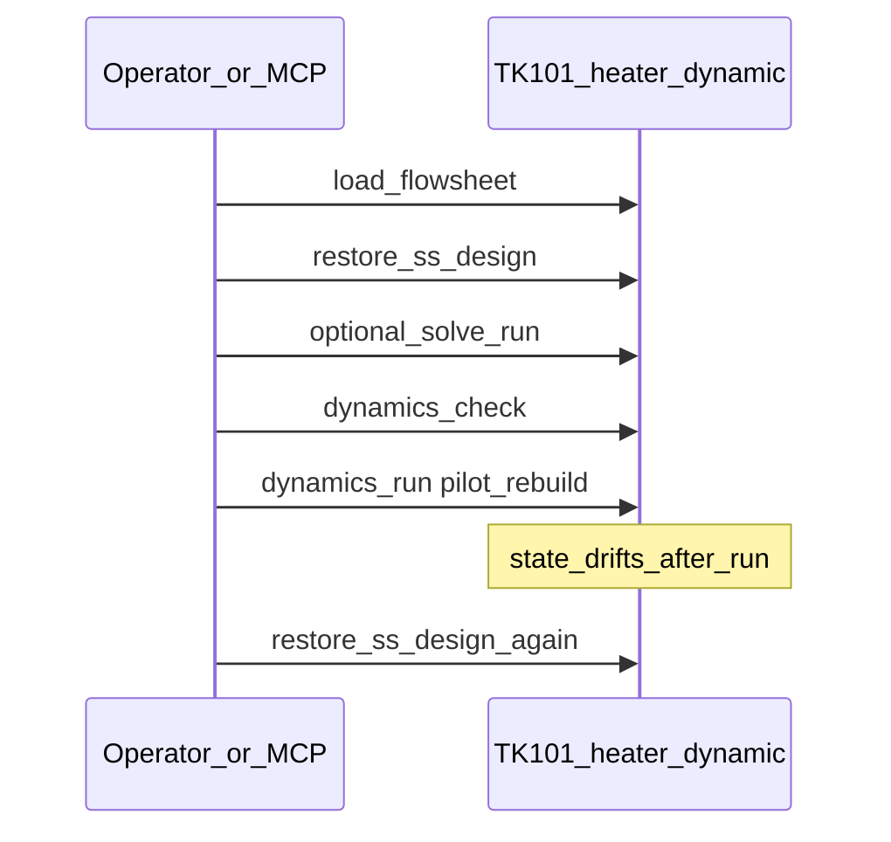
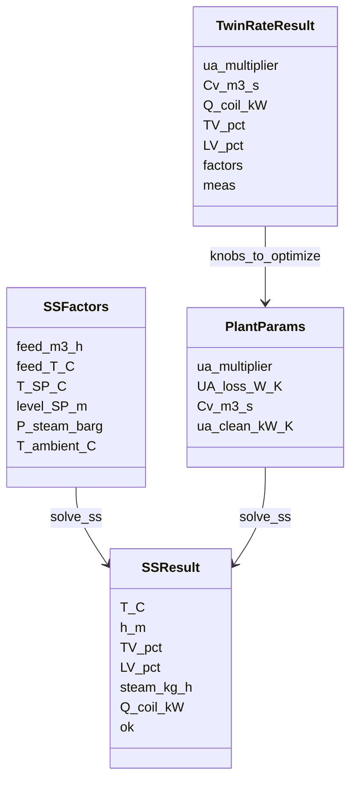

# As-built functional specification: TK-101 digital twin modes

As-built description of Simulate / Rate / Optimize, DOF Change/substitute, fouling detection, DWSIM artifacts, and dynamic kickoff. For a short overview see [`ARCHITECTURE.md`](ARCHITECTURE.md); for flowsheet limits see [`models/dwsim/NOTES.md`](../models/dwsim/NOTES.md).

## 1. Purpose and scope

| In scope | Out of scope |
|---|---|
| real_plant simulator → historian | Participant packaging (`participant/`, `blind_eval/`) |
| real_plant SS modes (`ss_modes.py`) | Changing real_plant physics or regenerating historian |
| digital twin path (`dwsim_twin.py`) + CLI | Automating DWSIM UI Change objects via MCP |
| Fouling compare, surrogate DOE | Full UML toolchains (PlantUML / draw.io) |
| Dynamic kickoff on `TK101_heater_dynamic.dwxmz` | |

**Roles:** the **real_plant simulator** (`challenge/plant/`, `baseline_ic.json`) generates the pilot historian. The **digital twin** (DWSIM + `dwsim_twin.py`) is for rate / optimize / fouling — it does not rewrite the historian.

## 2. System context



## 3. Roles and data flow



Pilot defaults (as coded):

| Step | Window / note |
|---|---|
| Clean rate | `[3600, 7200)` s (1–2 h) |
| Holdout (real_plant path) | `[10800, 14400)` s (3–4 h) |
| Fouled rate | `[36000, 39600)` s (10–11 h); E001 fouling after 8 h |
| Optimize | Maximize `feed_m3_h` ≤ 25 with TV/LV ≤ 90% |

## 4. Mode definitions

Shared SS solver: `solve_ss` closes level and temperature by **Adjust** of LV% and TV% (not PID). Coil law:

`UA_eff = UA_clean × ua_multiplier × R^(x_TV − 1)`

### 4.1 Simulate (Mode 1)

| Path | Entry | Behavior |
|---|---|---|
| real_plant | `ss_modes.simulate` / `scripts/twin_modes.py simulate` | Design (or given) `PlantParams`; vary `SSFactors` (feed, Tin, SPs, P_steam, Tamb) |
| digital twin | `dwsim_twin.simulate_twin` | Same algebra; optional `ua_multiplier` override |

**Intent:** forward prediction at known knobs / design basis.

### 4.2 Rate (Mode 2)

Fit or recover knobs from a quasi-steady historian window (`average_ss_window`).

| Path | Method | Knobs produced |
|---|---|---|
| **real_plant** | L-BFGS-B minimize residuals on TV%, LV%, steam vs `solve_ss` | `ua_multiplier`, `UA_loss_W_K`, `Cv_m3_s` → `challenge/plant/rated_baseline.json` |
| **digital twin** | Energy duty + measured TV% **back-calc** `ua_multiplier`; LV% + level → `Cv` | `ua_multiplier`, `Cv_m3_s` (+ design `UA_loss`) → `models/dwsim/twin_rated_*.json` |

As-built nuance: the two Rate implementations are **not identical**. digital twin Rate prefers historian `CALC-DUTY` when present, else process + loss energy balance.

### 4.3 Holdout / project (real_plant path)

| Mode | Behavior |
|---|---|
| `holdout` | Frozen rated knobs; predict a later SS window; pass/fail on T and LV tolerances |
| `project` | What-if on rated (or given) params with factor overrides |
| `check_outlier` | Flag meas vs model beyond T/TV/LV tolerances |

### 4.4 Optimize (Mode 3)

Load rated knobs → bisection on feed → maximize `feed_m3_h` subject to `TV_pct ≤ 90`, `LV_pct ≤ 90`, `feed ≤ 25`.

| Path | Function | Baseline file |
|---|---|---|
| real_plant | `ss_modes.optimize` | `rated_baseline.json` |
| digital twin | `dwsim_twin.optimize_twin` | `twin_rated_baseline.json` |

### 4.5 Fouling (digital twin path)

`detect_fouling(clean, candidate)`:

- Alarm if `ua_drop ≥ 0.15` **or** `ua_ratio ≤ 0.85`
- Diagnosis string `coil_fouling` when alarmed
- Signature: TV% up while `ua_multiplier` down at similar T (not steam-header collapse)

### 4.6 Surrogate DOE (digital twin path)

`surrogate_doe` / `scripts/twin_surrogate_sample.py`: space-filling samples of feed, Tin, T_SP, `ua_multiplier` → CSV responses (steam, TV%, LV%, duty).

## 5. DOF Change / substitute

Conceptual Change/Adjust (not a DWSIM UI Change-object SOP). Each mode substitutes which variables are **specified** vs **adjusted/calculated**.

### 5.1 Algebraic SS Adjust (all forward solves)

| Loop | Specified | Adjusted / calculated |
|---|---|---|
| LIC | `level_SP_m`, Fin (= Fout) | LV% from `Cv × x × √h` |
| TIC | `T_SP_C` (or measured T when rating) | TV% from coil law to meet Q_need |
| Energy | Feed Tin, P_steam, Tamb, knobs | Q_coil, steam, `CALC_EBAL` |

### 5.2 Mode substitution table

| Variable | Simulate | Rate (real_plant) | Rate (digital twin) | Optimize |
|---|---|---|---|---|
| Feed, Tin, SPs, P, Tamb | **Spec** (factors) | Frozen from meas window | Frozen from meas window | Spec (feed searched; others from baseline factors) |
| `ua_multiplier` | Spec (design / arg) | **Fitted** | **Back-calc** | Frozen from baseline |
| `UA_loss_W_K` | Spec | **Fitted** | Spec (design) | Frozen |
| `Cv_m3_s` | Spec | **Fitted** | **Back-calc** | Frozen |
| TV%, LV% | Calculated (Adjust) | Match targets in residual / report | From meas (inputs to back-calc) | Calculated; constrained ≤ 90% |
| Q / steam | Calculated | Calculated + residual vs FIC-201 | Duty from energy / CALC-DUTY | Calculated |





## 6. Fouling detection (detail)



At SS with T held, duty is fixed by energy balance. Fouling appears as **higher TV%** for the same duty → lower recovered `ua_multiplier`. Pilot E001 typically drives rated `ua_multiplier` toward ~0.6.

## 7. DWSIM artifact map

| File | Role |
|---|---|
| `TK101_twin_ss.dwxmz` | digital twin SS flowsheet (heater + tank) referenced by twin JSON |
| `twin_rated_baseline.json` / `twin_rated_fouled.json` | Rated knobs from historian windows |
| `twin_surrogate_doe.csv` | Optional ML DOE samples |
| `TK101_heated_tank.dwxmz` | SS HX topology cross-check (~75.8 °C, ~885 kW) |
| `TK101_heater_dynamic.dwxmz` | Dynamic open-loop; kickoff state `ss_design` |
| `TK101_heater_pf.dwxmz` | Experimental PF + LV-101 + SS Adjust `ADJ-LIC` |

### digital twin vs real_plant physics (as built)

| Item | real_plant simulator | digital twin / DWSIM files |
|---|---|---|
| Coil | `UA_eff = UA_clean·R^(x−1)` | Same law on historian TV% + duty; flowsheet heater supplies energy/flash |
| Controls | TIC→FIC→TV, LIC→LV (dynamic PID) | SS: Adjust/specs; dyn PID not required for twin rate |
| Feed routing | Direct to tank + submerged coil | Heater-then-tank (or SS HX) simplification |
| Historian | Generated here | Never used as generator |

### Known limits

- Dual flow-spec dynamic file keeps level flat (no inventory response).
- PF/Kv path can move level but holdup restore to 2 m is unreliable via Dynamics Manager.
- MCP cannot create PID objects; Adjust ObjectData needs UI or XML patch.
- SS HX file routes feed through E-101 — intentional simplification, not submerged-coil identity.

## 8. Dynamic kickoff sequence

Persisted in `TK101_heater_dynamic.dwxmz`:

| Item | Value |
|---|---|
| Stored state | `ss_design` (~72 °C, 15 t/h, 885 kW, level 2 m) |
| Schedule | `pilot_rebuild` (starts from `ss_design`) |
| Integrator | `pilot_rebuild_int` |



Rules:

1. Always restore `ss_design` before a dynamic run.
2. After a run, restore again (or reload). Do **not** overwrite `ss_design` with post-run drifted state unless the owner asks.
3. Keep HTR-101 / TK-101 `Initialize using Inlet Stream = 0` so restore is not wiped by cold feed.

## 9. CLI and entry points

```bash
# real_plant SS modes
python scripts/twin_modes.py simulate|rate|holdout|optimize|project|demo

# digital twin path (+ fouling)
python scripts/dwsim_twin_modes.py simulate|rate|fouling|optimize|demo
python scripts/twin_surrogate_sample.py -n 128

# Historian (from real_plant simulator)
python scripts/run_pilot.py
```

## 10. Types (class view)



## 11. Traceability

| Concern | Code / artifact |
|---|---|
| real_plant simulator (dynamic) | `challenge/plant/model.py`, `controllers.py`, `design.py` |
| Historian export | `challenge/historian/export.py`, `scripts/run_pilot.py` |
| real_plant Simulate/Rate/Holdout/Optimize | `challenge/plant/ss_modes.py`, `scripts/twin_modes.py` |
| digital twin Rate/Fouling/Optimize/DOE | `challenge/plant/dwsim_twin.py`, `scripts/dwsim_twin_modes.py` |
| digital twin flowsheet + rated JSON | `models/dwsim/TK101_twin_ss.dwxmz`, `twin_rated_*.json` |
| Dynamic kickoff | `models/dwsim/TK101_heater_dynamic.dwxmz`, `.cursor/rules/dwsim-ss-kickoff.mdc` |
| Architecture summary | `docs/ARCHITECTURE.md` |
| File limits | `models/dwsim/NOTES.md` |
